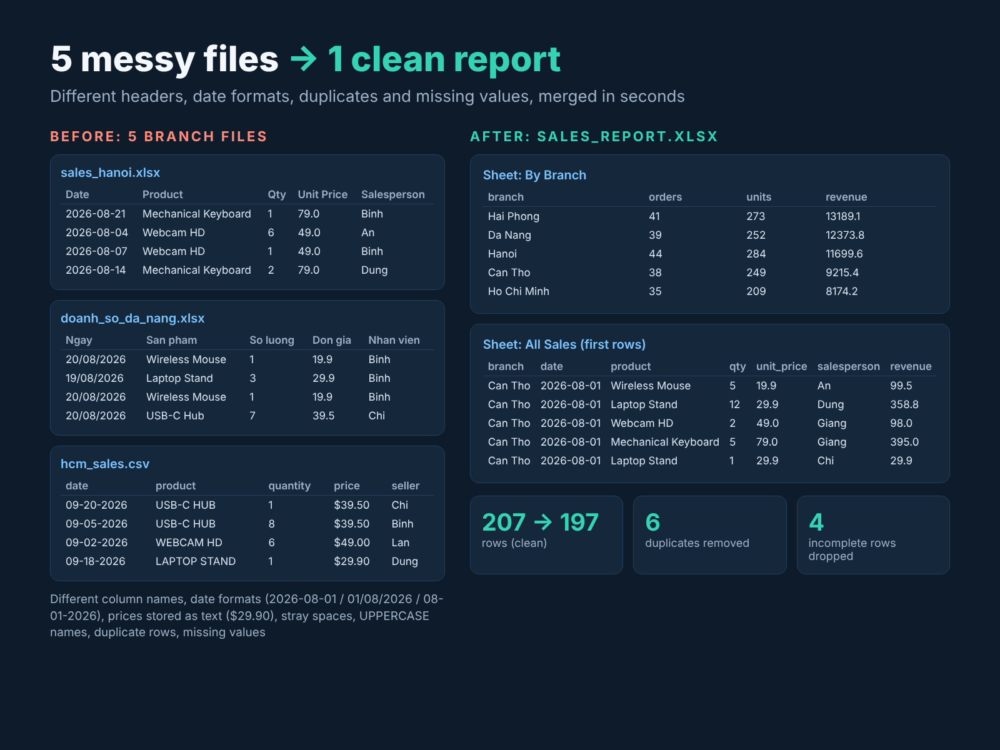
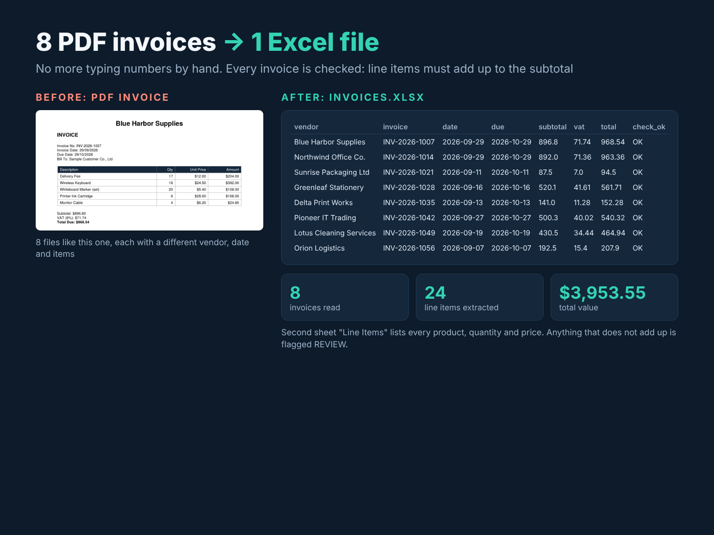

# Python Automation Demos

Two small, practical Python automation examples. All data is **fake sample data** generated by the scripts in this repo.

## 1. Merge messy Excel/CSV files → one clean report
[`demo1_merge_excel`](./demo1_merge_excel)

Five branch sales files with different column names, date formats, text prices, duplicates and missing values are merged into one Excel report with summaries by branch, product and month.



## 2. Extract invoice data from PDFs → Excel
[`demo2_pdf_to_excel`](./demo2_pdf_to_excel)

Reads PDF invoices into an Excel file (invoice header + line items). Every invoice is checked: if the line items do not add up to the subtotal, it is flagged for review.



## Tech
Python, pandas, openpyxl, pdfplumber

## Run
Each folder has its own README and `requirements.txt`:

```
cd demo1_merge_excel
pip install -r requirements.txt
python make_sample_data.py
python merge_sales.py
```

## Need something similar?
I build custom Python automation: Excel/CSV processing, web scraping and PDF data extraction.

Upwork: https://www.upwork.com/freelancers/~010d9000e2b9af1ca9
